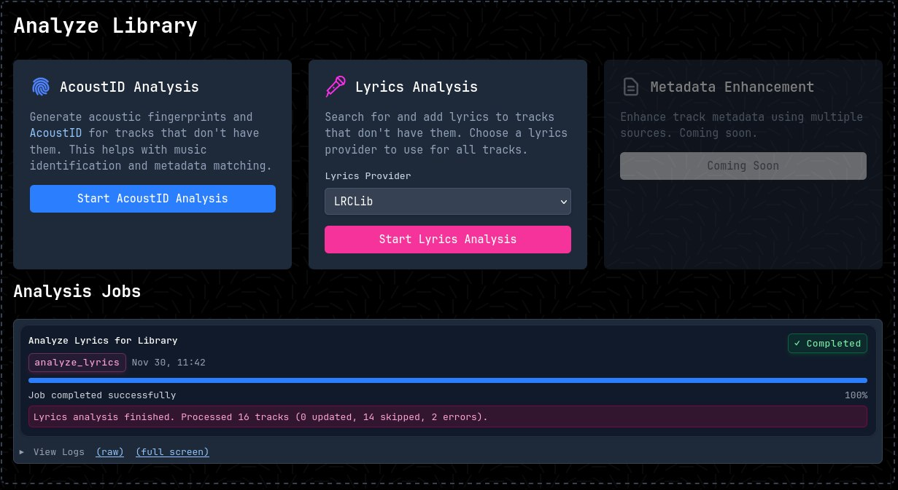
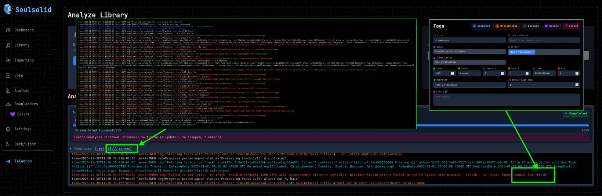

The analyze feature runs an analysis of the metadata of your library and fills in the missing gaps.

## Analyze Jobs

Each analysis runs as a background [job](jobs.md) and can be started from the **Analyze** section of the web UI.

### AcoustID Analysis

The AcoustID analysis job computes acoustic fingerprints for your audio tracks and matches them against the [AcoustID database](https://acoustid.org/). This helps identify songs accurately, filling in missing or incorrect metadata such as track titles, artists, albums, and other tags. It's particularly useful for tracks with incomplete information or those obtained from unknown sources.

### Lyrics Analysis

The Lyrics analysis job searches for and adds lyrics to your tracks using configured providers. Currently supported providers include:

- **Lrclib**: A lyrics database that provides synchronized (LRC timestamped) and plain text lyrics.

The job attempts to fetch lyrics for all tracks. For tracks that already have lyrics, you can control the behavior with two options available in the UI:

- **Skip existing**: skip tracks that already have lyrics entirely
- **Override without queuing**: apply new lyrics immediately if they differ, without a manual review step

If neither option is set, tracks with differing existing lyrics are sent to the lyrics queue for manual review. See the [Lyrics](lyrics.md) docs for queue type details.

### File Paths (Reorganize)

Applies the current path templates to every track in the library and moves files to match. See [Reorganize Library](paths.md#reorganize-library).

### Merge

Finds artists, albums and genres that are the same but spelled differently (for example
`Hip-Hop` and `Hip Hop`) and lets you merge them into one. It also finds duplicate
tracks (the same recording stored in more than one file) using AcoustID. See
[Merge](features/merge.md).

## Job Logs



This is how the job logs look. You can browse these logs and see which tracks were processed correctly and which failed. Failed tracks have a `manual_fix="track"` link: click it to open the track in the tag editor and fix it by hand.

```text
time=2025-11-30T11:42:34.416+01:00 level=INFO msg="Starting job" name="Analyze Lyrics for Library"
time=2025-11-30T11:42:34.416+01:00 level=INFO msg="EXECUTE STARTED: Lyrics job task is running" color=pink
time=2025-11-30T11:42:34.416+01:00 level=INFO msg="Enabled lyrics providers" providers="map[dummy:true lrclib:true]" color=blue
time=2025-11-30T11:42:34.416+01:00 level=INFO msg="Starting lyrics analysis" totalTracks=16 color=blue
time=2025-11-30T11:42:34.416+01:00 level=INFO msg=Progress percentage=0 status="Starting analysis of 16 tracks"
time=2025-11-30T11:42:34.424+01:00 level=INFO msg=Progress percentage=0 status="Processing track 1/16: 4 + 20"
time=2025-11-30T11:42:34.424+01:00 level=INFO msg="Skipping track with existing lyrics" trackID=5a56532c-9f5b-57d0-a9eb-c7e6f81cac77 title="4 + 20" lyricsLength=661 color=orange
time=2025-11-30T11:42:36.890+01:00 level=ERROR msg="Failed to add lyrics for track" trackID=c3fded61-1a6b-5fbb-ac51-ce1ec30ae07c title="A contraluz" provider=lrclib error="failed to search lyrics with provider 'lrclib': no lyrics found" manual_fix="track"
time=2025-11-30T11:42:36.890+01:00 level=INFO msg=Progress percentage=6 status="Processing track 2/16: Almost Cut My Hair"
time=2025-11-30T11:42:38.569+01:00 level=INFO msg="Lyrics analysis completed" totalTracks=16 processed=2 updated=0 skipped=14 color=green
```
