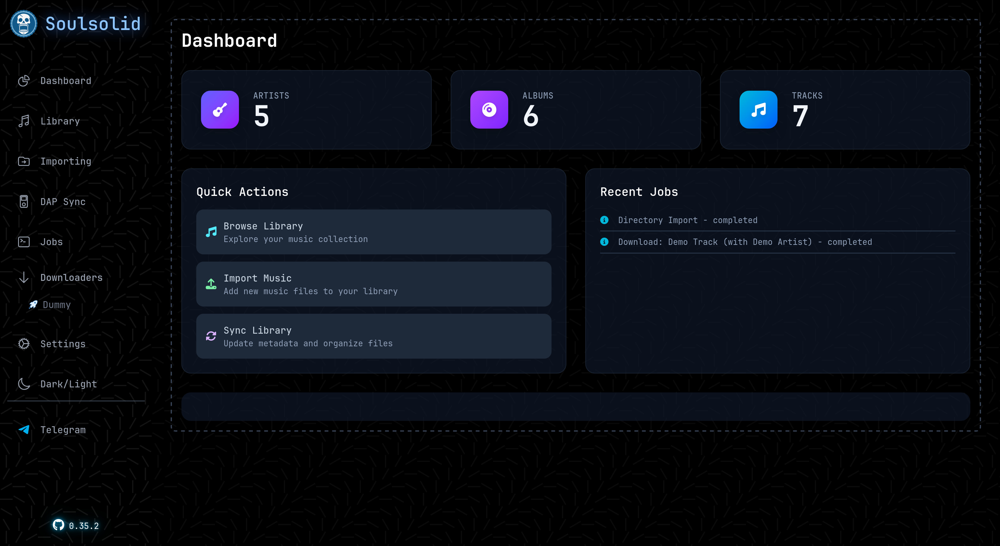
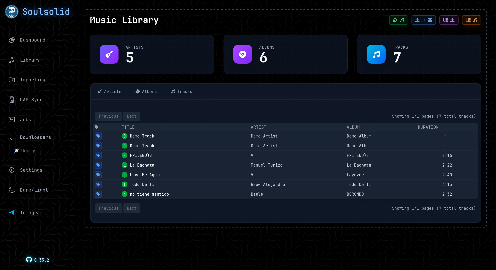
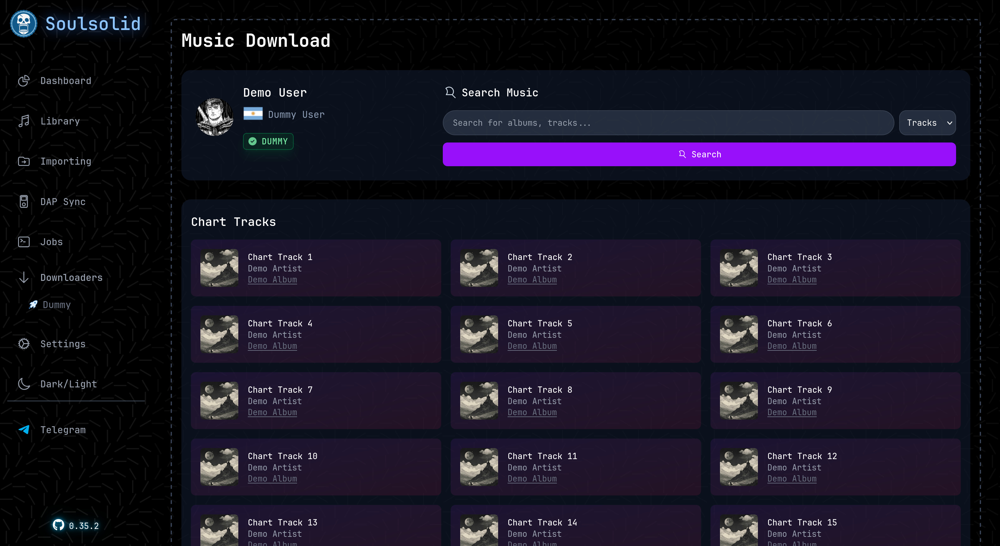
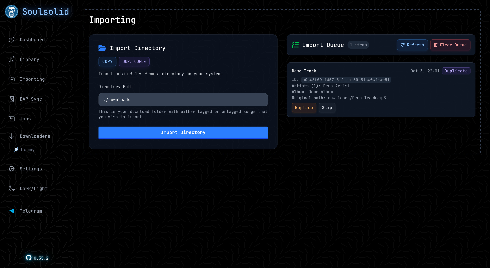
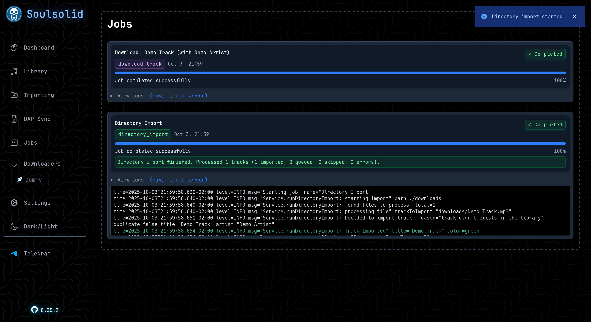
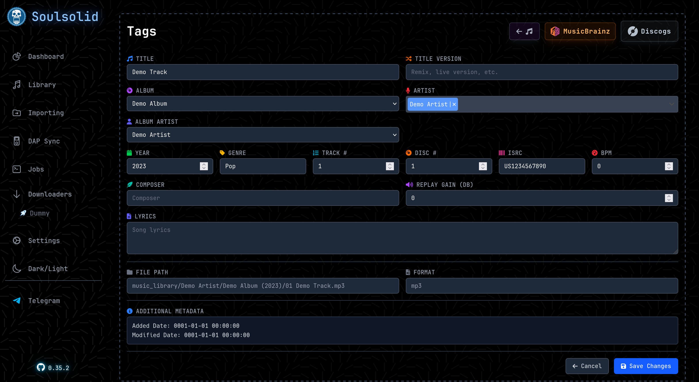
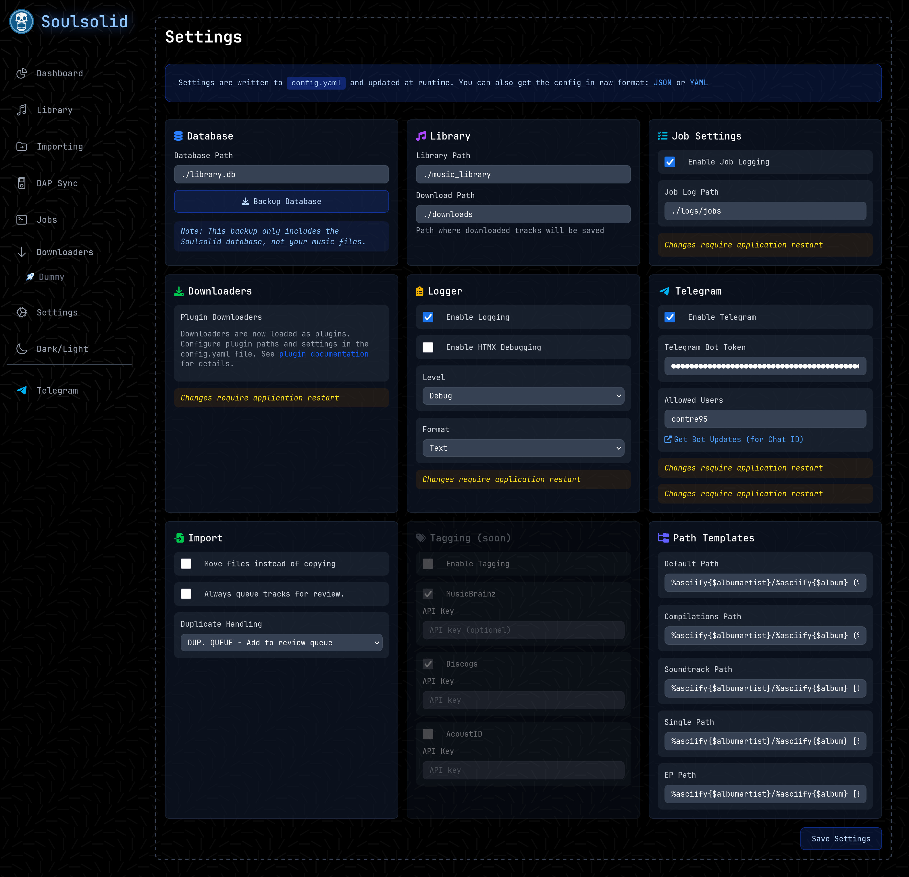

Here are some screenshots of the Soulsolid application interface. You can also try the
read-only [demo](https://soulsolid-demo.contre.io).

*Main dashboard interface*

*Library browsing and organization*

*Downloading tracks using the example dummy plugin*

*Importing music from directories*

*Managing background jobs and notifications*

*Tag management for music library*

*App configuration options*
